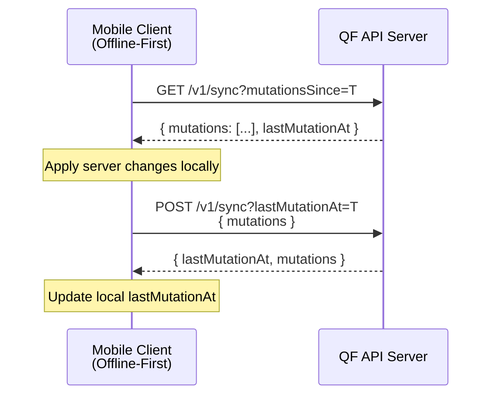
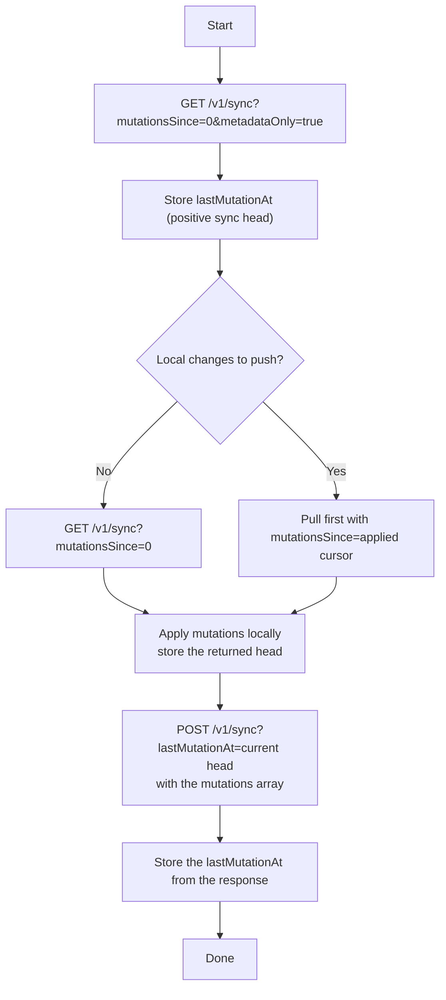

# Getting Started with Data Sync

The Quran Foundation Sync API enables **offline-first mobile applications** to synchronize user data
across devices. This guide covers the core concepts and helps you implement your first sync flow.

:::warning Pre-live only
The Sync API endpoints (`GET /v1/sync` and `POST /v1/sync`) are currently available in pre-live only. Endpoint paths in this guide are relative to the User API auth base URL: `https://apis-prelive.quran.foundation/auth` for pre-live, and `https://apis.quran.foundation/auth` for production direct endpoints. If the generated API reference shows a production server option for `/v1/sync`, do not use it yet; production `/v1/sync` is not supported until the Sync API is promoted.

Production clients should continue using the direct User API endpoints until the Sync API is promoted to production. For Quran.com Favorites/default collection bookmarks in production, use `POST /v1/collections/__default__/bookmarks` to add Favorites. To remove Favorites, prefer `DELETE /v1/collections/__default__/bookmarks/{bookmarkId}` when you have the bookmark ID, or use `DELETE /v1/collections/__default__/bookmarks` with a JSON body containing either `bookmarkId` or the bookmark details.
:::

## Overview

The Sync Layer provides:

1. **Pull Changes** — Fetch all mutations (creates, updates, deletes) that occurred after a timestamp
2. **Push Changes** — Batch-submit local mutations made while offline
3. **Conflict Detection** — Prevents data conflicts using `lastMutationAt` timestamps

## Prerequisites

Before using the Sync API, ensure you have:

1. **OAuth2 Client Credentials** — [Set up OAuth2](/docs/tutorials/oidc/getting-started-with-oauth2) for your app
2. **Required Scopes** — Request these scopes during authorization:
   - [`sync`](/docs/user_related_apis_versioned/scopes#sync) — Required for `GET /v1/sync` and `POST /v1/sync`
   - [`bookmark`](/docs/user_related_apis_versioned/scopes#bookmarks) — For syncing bookmarks
   - [`collection`](/docs/user_related_apis_versioned/scopes#collections) — For syncing collections
   - [`note`](/docs/user_related_apis_versioned/scopes#notes) — For syncing notes

:::tip Scope Requirements
You only receive mutations for resources your token has access to. If you request [`sync`](/docs/user_related_apis_versioned/scopes#sync) + [`bookmark`](/docs/user_related_apis_versioned/scopes#bookmarks) but not [`collection`](/docs/user_related_apis_versioned/scopes#collections), you won't see collection changes.
:::

## Supported Resources

The Sync API currently tracks these resources. All `/v1/sync` calls also require the [`sync`](/docs/user_related_apis_versioned/scopes#sync) scope.

| Resource              | Description                        | Required Scope                                                                                                                         |
| --------------------- | ---------------------------------- | -------------------------------------------------------------------------------------------------------------------------------------- |
| `BOOKMARK`            | User bookmarks (ayah, surah, etc.) | [`bookmark`](/docs/user_related_apis_versioned/scopes#bookmarks)                                                                       |
| `COLLECTION`          | User collections                   | [`collection`](/docs/user_related_apis_versioned/scopes#collections)                                                                   |
| `COLLECTION_BOOKMARK` | Bookmarks within collections       | [`bookmark`](/docs/user_related_apis_versioned/scopes#bookmarks), [`collection`](/docs/user_related_apis_versioned/scopes#collections) |
| `NOTE`                | User notes/reflections             | [`note`](/docs/user_related_apis_versioned/scopes#notes)                                                                               |

:::note Resource IDs vs composite keys
For `BOOKMARK`, `COLLECTION`, and `NOTE`, sync mutations include a single `resourceId`.
For `COLLECTION_BOOKMARK`, there is no single ID; omit `resourceId`. Create mutations identify the bookmark by a collection-bookmark request body plus `data.collectionId`: ayah bodies use `key` and `verseNumber`, while surah/juz/page bodies use `key`; include `type`, `mushafId`, and `mushaf` according to the collection bookmark schema. Delete mutations may use either those same bookmark details or `data.bookmarkId`, always with `data.collectionId`. Pull responses can include `data.bookmarkId` because the backend has already resolved the bookmark to its stored ID.
:::

:::note Favorites/default collection
The Quran.com Favorites collection uses the virtual collection ID `__default__`.

After the pre-live backend support is deployed, push Favorites changes through `POST /v1/sync` as `COLLECTION_BOOKMARK` mutations with `data.collectionId: "__default__"`. Create mutations use a collection-bookmark request body: ayah bodies use `key` and `verseNumber`, while surah/juz/page bodies use `key`; include `type`, `mushafId`, and `mushaf` according to the collection bookmark schema. Delete mutations may use either `data.bookmarkId` or the same bookmark details. The virtual collection does not create a real `CollectionBookmark` row, so pull-sync clients should read default collection membership from `BOOKMARK.isInDefaultCollection`, not from a separate `COLLECTION_BOOKMARK` mutation.

Production clients should keep using the direct collection endpoints until `/v1/sync` is promoted to production. Use `POST /v1/collections/__default__/bookmarks` to add Favorites. To remove Favorites, prefer `DELETE /v1/collections/__default__/bookmarks/{bookmarkId}` when you have the bookmark ID, or use `DELETE /v1/collections/__default__/bookmarks` with a JSON body containing either `bookmarkId` or the bookmark details.
:::

## Key Concepts

### lastMutationAt

`lastMutationAt` is the user's **sync head**: a server-assigned Unix timestamp in milliseconds for the most recent mutation, including virtual resources such as the default Favorites collection.

- **Authoritative on the server** — it is always assigned by the server; clients never invent it
- **Stored locally** — persist the value returned by the latest `GET` or `POST`
- **Sent as a precondition on push** — `POST /v1/sync` requires the current head and rejects a stale or different value with `409`

`lastMutationAt` is **not** the pull cursor. Pull with `mutationsSince`, which is the timestamp of the last mutation your client has applied.

### First Sync Behavior

There is no "first sync" sentinel value. A brand-new user still gets a positive `lastMutationAt`, because the sync head includes virtual resources such as the default Favorites collection.

| Scenario                        | Server Response                          | Client Action                                                         |
| ------------------------------- | ---------------------------------------- | --------------------------------------------------------------------- |
| No local state yet              | `lastMutationAt: <positive timestamp>`   | Store the head, pull with `mutationsSince=0`, push with the stored head |
| First mutation from this device | Returns the new head                     | Store the returned `lastMutationAt`                                    |
| Another device synced first     | `409 OutOfSyncError` on push             | Pull, replay local changes, push again with the new head               |

:::warning Do not send `-1`
`POST /v1/sync` accepts only the head returned by the most recent `GET`, pull, or push. Sending `-1`, `0`, or a value captured before a pull returns `409 OutOfSyncError`.
:::

## Quick Start: Your First Sync

### Step 1: Read the Sync Head

Call `GET /v1/sync` with `metadataOnly=true` to read the current head without fetching mutations. (You still need to pass `mutationsSince`, even when `metadataOnly=true`.)

- The response is always a positive `lastMutationAt`, including for a user with no history
- Store it: it is the precondition for your next push

### Step 2: Pull and Apply Mutations

Call `GET /v1/sync?mutationsSince=<cursor>` with `mutationsSince=0` for a full pull, and apply each mutation locally. Persist `lastMutationAt` only after the final page.

For pagination, page 2 and later must send the `lastMutationAt` returned by page 1. If the head moves while you are paging, the request fails with `409` and the pull must restart from page 1 with the original cursor.

### Step 3: Push Local Changes

When the user creates data offline, send `POST /v1/sync?lastMutationAt=<current head>` with up to 100 mutations, using the head returned by the latest `GET`, pull, or push. Store the head returned by the response.

If the push returns `409 OutOfSyncError`, another device wrote first: pull, replay the local changes on top, then push again with the new head.

### API References

- [GET /v1/sync (Get mutations)](/docs/user_related_apis_prelive/get-mutations/)
- [POST /v1/sync (Sync local mutations)](/docs/user_related_apis_prelive/sync-local-mutations/)

## Using metadataOnly for Efficiency

The `metadataOnly=true` parameter returns only the `lastMutationAt` without fetching mutations. Use it for:

1. **Pre-sync checks** — Quickly check if new data exists before a full sync
2. **Background polling** — Efficiently detect changes without heavy payloads
3. **Recovering state** — If you missed the `X-Mutation-At` header from a previous response

This is significantly faster than a full sync (single DB query vs multiple joins).

For the full request/response schema, see:

- [GET /v1/sync (Get mutations)](/docs/user_related_apis_prelive/get-mutations/)

## Filtering & Pagination

`GET /v1/sync` supports resource filtering and pagination:

- `resources=BOOKMARK,COLLECTION` limits results to those resources
- `limit` and `page` paginate results (max `limit` is 1000)
- Continue fetching pages until `hasMore=false`
- Page 2 and later must also send the `lastMutationAt` returned by page 1. A missing continuation head, or a head that changed between pages, returns `409` and the pull restarts from page 1.

When `metadataOnly=true`, the response includes only `lastMutationAt` (no pagination fields).

## Important Notes

- **Mutation limits** — `POST /v1/sync` accepts a maximum of 100 mutations per request.
- **Pre-live references** — The API reference links above intentionally point to the pre-live Sync API pages while `/v1/sync` remains pre-live-only.
- **Favorites/default collection** — Use `COLLECTION_BOOKMARK` with `data.collectionId: "__default__"` to push default collection membership in pre-live. Create with a collection-bookmark request body: ayah bodies use `key` and `verseNumber`, while surah/juz/page bodies use `key`; include `type`, `mushafId`, and `mushaf` according to the collection bookmark schema. Delete with either `data.bookmarkId` or bookmark details. Pull default membership from `BOOKMARK.isInDefaultCollection`.

## Next Steps

- [Handling Conflicts](/docs/tutorials/sync/handling-conflicts/) — Learn how to handle 409 errors and resolve conflicts
- [Offline-First Patterns](/docs/tutorials/sync/offline-first-patterns/) — Best practices for client-side architecture
